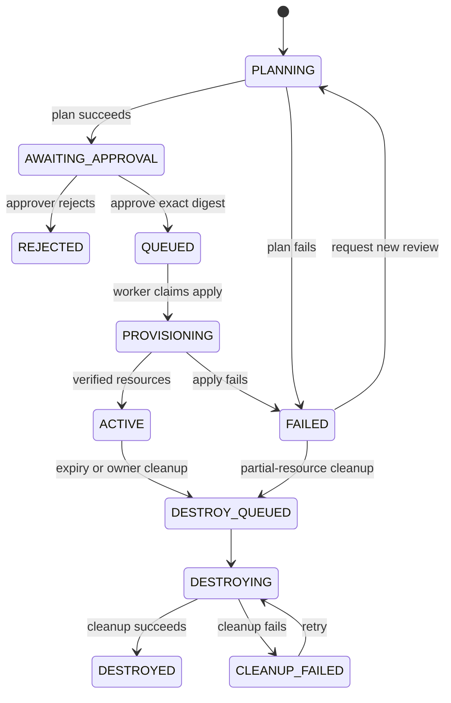

# Architecture and explicit decisions

## Two experiences

The same static interface has two deliberately separate clients:

- **Browser demonstration:** simulated requests in browser storage, runbook search, and illustrations of incident tests. It uses no backend and works on GitHub Pages.
- **Local API mode:** generated bearer credentials, persisted SQLite requests, a background worker, and actual boto3 HTTP calls to Moto. Tokens remain in tab memory and are never included in the public site.

The interface never labels browser actions as actual infrastructure provisioning. Incident illustrations do not show fabricated passing test results or measured latency.

## Request state machine

## Durable orchestration

SQLite write transactions serialize idempotency, approval, and job creation. A partial unique index allows only one pending/running infrastructure job per request. The worker claims jobs transactionally and records successful or failed state transitions.

On startup, interrupted jobs return to pending. Infrastructure operations use deterministic request-specific names, ownership checks, and idempotent reconciliation. Cleanup tolerates already-removed resources. A failed apply can leave partial infrastructure; its TTL is established before the apply attempt so that those resources also become eligible for cleanup.

Cleanup retries up to five attempts with a increasing delay. Exhausted cleanup remains visibly failed until the issue is corrected and cleanup is requested again. A provision retry always generates a new plan and requires another explicit approval.

The embedded scheduler uses the same durable queue and the application's clock. It replaces EventBridge for the free local edition. There is no claim that cloud scheduling is deployed. Cleanup occurs while the app is running; expired requests are picked up after restart.

## Infrastructure executors

| Executor | Review artifact | Apply behavior |
| --- | --- | --- |
| `api` | Deterministic preview of allowlisted SDK operations | boto3 provisions and verifies the template |
| `terraform` | Actual saved Terraform plan; digest of plan bytes | Applies only the exact approved saved file |
| `jenkins` | Jenkins runs the Terraform plan and publishes result.json | A separate Jenkins job applies the approved saved file |

The API preview is labeled as an API preview, not a Terraform plan. Terraform uses request-specific state directories, a checked-in provider lock, fixed fake credentials, and explicit local S3/IAM/STS endpoints.

## Authentication and boundaries

- Credentials are generated locally, never shipped as default usable passwords.
- Requesters see their own requests. Approvers see all local requests.
- Slack uses verified workspace/user IDs. Approval authority comes from configured user IDs, never display names or payload role fields.
- Slack HTTP requests require an HMAC signature and fresh timestamp. Socket Mode uses a separate local bridge token.
- Approval buttons carry the reviewed plan digest, so a stale message cannot approve a later plan.
- User parameters are validated before provisioning and passed as argument arrays or structured environment data, never interpolated into shell commands.
- Infrastructure endpoints and local model endpoints are restricted to explicit local hosts. AWS SDK calls use fake credentials, not ambient AWS account credentials.
- Client transports ignore ambient proxy variables; this prevents local requests and account credentials from being sent through an unexpected proxy. A corporate proxy would need an explicit transport adaptation.
- Local API access is restricted to expected hostnames, with no public CORS access. Docker ports bind only to 127.0.0.1.
- Audit hashes detect changes to existing records, but an attacker with full database access could recompute a chain. This is not an immutable compliance archive.

## Grounded troubleshooting

Runbook retrieval requires at least two relevant non-stopword overlaps. The local model receives only retrieved runbook steps and selects step IDs via a JSON schema. The response renders the stored step text and citations, not invented model prose. Unknown IDs or model errors trigger an explicitly labeled extractive fallback. Questions without enough retrieval evidence receive an abstention.

The assistant has no execution tools and cannot modify requests, permissions, or infrastructure.

## Justified assumptions

| Decision | Reason |
| --- | --- |
| One private storage sandbox template | Demonstrates the role's automation stack with a scope that can be tested thoroughly |
| Local AWS emulator | Strict free-resource requirement; live AWS cannot be guaranteed to incur no charges |
| FastAPI and Python | Directly builds on the existing resume's Python/FastAPI experience |
| Vanilla browser interface | GitHub Pages compatibility with no build service, account, or UI framework dependency |
| SQLite and one worker | Appropriate for a local portfolio application; avoids requiring a paid database or broker |
| Local model inference is optional | No paid model API; users' available memory and hardware are unknown |
| ServiceNow integration is disabled initially | An accessible developer instance was not supplied; the local ticket system is complete independently |
| Public Pages demo | GitHub Free supports Pages in public repositories; publication still uses the actual authenticated account |

This edition is a development portfolio system. It is not a multi-tenant production IT service or a live Guidewire implementation.
